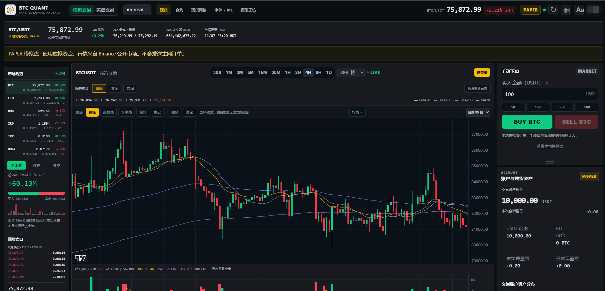

# BTC Quant Console 1.0

**本地优先的数字资产交易与策略研究工作区。**  
**A local-first workspace for digital-asset trading and strategy research.**

中文说明在前，English follows below.

[中文 API 教程](#api-获取与连接教程) · [English API tutorial](#api-setup-tutorial)

## 界面预览 / Interface preview



现货模拟交易界面（PAPER）：市场观察、K 线与成交量图、手动订单和账户概览。  
Spot paper-trading workspace: market watch, candlestick and volume charts, manual orders and account overview.

## 中文

### 项目目标

将行情图表、模拟交易、交易所连接、订单核对与策略研究放在同一个本地工作区。以清楚的账户状态、明确的订单确认和可追踪的执行过程改善个人操作体验。

### 主要功能

| 模块 | 功能 |
| --- | --- |
| 行情与图表 | BTC、ETH、BNB、XRP、TRX、DOGE 交易对；K 线、成交量、均线、绘图工具及多图布局。 |
| 模拟交易 | 本地现货、合约及网格模拟，支持在配置实盘连接前熟悉界面与流程。 |
| 现货操作 | Binance 现货连接、市价与限价订单、数量步长和金额校验、比例卖出、订单预览与确认。 |
| 执行与核对 | 提交期间锁定表单、按确认号跟踪回执、部分成交展示、状态未知时核对及重复提交防护。 |
| 交易所能力 | 将行情、账户读取、手动订单、AUTO 与网格的支持状态分别展示。支持不等于已连接或已通过实盘验收。 |
| 合约与网格 | 参数配置、模拟流程及市场状态展示；真实操作按适配器、权限和实际验证状态开放。 |
| 策略研究 | 趋势策略、事件研究、机器学习相关研究界面及本地模型接入接口。 |

### 当前边界

- 软件默认使用本机回环地址，适合个人本地运行。
- PAPER 启动方式会禁用实盘接口。实盘需要使用者自行配置交易所 API，并通过权限和连接核验。
- 各交易所、各市场的能力和可用性不同；合约及真实网格的接入与验收状态需分别确认。
- 测试结果来自隔离环境；完整的真实账户、持续运行和升级迁移验收需要在相应环境执行。
- 首次发布包含源码与重新构建的 Windows x64 发行包。不会随包提供任何个人 API 凭据、账户账本或交易日志。

### Windows 快速开始

1. 从 [Releases](https://github.com/Coribri/BTCQuantConsole/releases) 下载 `BTCQuantConsole-1.0-win64.zip`。
2. 完整解压，保留 `BTCQuantConsole.exe` 与 `_internal` 的目录关系。
3. 双击 `Start-PAPER.bat` 启动模拟模式，访问 `http://127.0.0.1:18787`。
4. 使用实盘工作区时，先关闭当前模拟进程，再运行 `Start-LIVE.bat`，打开 `http://127.0.0.1:18787/?account=live`。
5. 在软件中自行配置 API。先读取并核对账户，再预览具体订单。

每个运行目录拥有独立的配置和账本。升级或切换目录时，先确认数据归属，并保留自己的 `config.toml` 与 `runtime` 备份。

### API 获取与连接教程

教程核对日期：2026-11-07。下面按 **Binance 现货主网**和 **DeepSeek** 的实际入口说明；官网菜单与权限以你的账户页面为准。

#### 1. 先确定需要哪一种 API

| 使用场景 | 是否需要密钥 | 在本平台哪里使用 |
| --- | --- | --- |
| 查看公开行情、使用现货/合约/网格本地模拟 | 不需要 | 运行 `Start-PAPER.bat`，进入模拟交易。 |
| 读取 Binance 真实账户或手动现货交易 | Binance API Key + API Secret | 运行 `Start-LIVE.bat`，进入实盘现货的「API 连接设置」。 |
| 事件解析、AI 分析、模型中的 AI 功能 | DeepSeek API Key，可选 | 「事件 + ML」→「DeepSeek 连接设置」。 |

交易所密钥和 DeepSeek 密钥分别配置。只体验模拟交易时可以全部留空。

#### 2. 获取 Binance API

1. 登录 [Binance 官网](https://www.binance.com/)，在账户页面进入「API 管理 / API Management」，选择「创建 API」。账户须满足官网显示的身份验证、2FA 和开通条件。
2. **1.0 仅实现 HMAC 签名**：如果账户仍提供「系统生成 / System generated」，创建一组 API Key 与 Secret Key，可命名为 `BTCQuantConsole-local`。创建流程见 [Binance 官方教程](https://www.binance.com/en/support/faq/detail/360002502072)。
3. 首次连接先保留读取权限。需要真实现货下单时，再启用相应现货交易权限；**本教程不需要提现或资金划转权限**。
4. 配置 API 的可信 IPv4 白名单，使用运行本软件电脑的**公网出口 IP**；`127.0.0.1` 和局域网 IP 不能作为该出口地址。更换网络或代理后重新核对。权限受限时按官网要求配置 IP，保留账户安全控制。
5. 将配套的 Key 与 Secret 保存在自己的安全位置，随后填入本机软件。

**密钥类型兼容性：** [Binance 当前密钥类型文档](https://developers.binance.com/en/docs/products/spot/faqs/api_key_types)已将 HMAC 标记为弃用，并推荐 Ed25519。1.0 尚未实现 Ed25519/RSA 签名；如果账户只提供这些类型，当前版本无法直接连接，需等待适配。不要将 RSA/Ed25519 私钥填入 API Secret。

#### 3. 在平台连接 Binance 现货

1. 关闭正在运行的模拟进程，双击 `Start-LIVE.bat`，打开 `http://127.0.0.1:18787/?account=live`。
2. 选择「现货」「实盘交易」，交易所选择 **Binance**。
3. 在右侧账户区展开「API 连接设置」，分别填写 **API Key** 和 **API Secret**，点击「保存连接」。此入口使用主网密钥；测试网 / Demo 密钥不能混填。
4. 保存后软件会尝试读取账户；也可点击「读取账户」或「重新检测」。核对币种、可用余额、连接状态与 Binance 现货账户是否一致。**保存成功仅表示本地配置已写入，账户读取成功才说明读取链路可用。**
5. 仅开启读取权限时，下单保持锁定。确需手动下单时，先在 Binance 授予相应权限，再重新检测，确认界面提示交易权限已核验。
6. 核对「手动下单上限」，保持测试模式，先用订单预览检查交易对、方向、金额、数量与交易所限制。完成最终确认会向主网提交真实订单；保存连接和读取账户本身不会下单。

合约、AUTO 和真实网格须在各自市场页面分别核验能力、账户与权限。现货连接成功不能替代其他市场的验收；首次配置先完成上面的账户读取流程。

#### 4. 获取并连接 DeepSeek（可选）

1. 登录 [DeepSeek 开放平台的 API Keys 页面](https://platform.deepseek.com/api_keys)，创建自己的 API Key。API 账号的可用额度在开放平台管理。
2. 打开本机 `http://127.0.0.1:18787/research`，或点击顶部「事件 + ML」，再点击「DeepSeek 连接设置」。
3. 填写 API Key，模型名称可先使用 `deepseek-flash`，点击「保存本地设置」。可用模型以 [DeepSeek 官方文档](https://api-docs.deepseek.com/)及你的 API 账户为准。
4. 页面显示「DeepSeek 已配置」表示 Key 已保存。点击 AI 多空展望区的「生成分析」，收到有效结果后才完成实际调用验证；该操作会使用 API 额度。
5. 需要事件解析时，先「采集公开事件」，再「DeepSeek 解析」。需要模型中的 AI 功能时，到「模型工坊」为对应模型选择 AI 模式；保存 Key 不会自动启动 AUTO。

1.0 的此项连接使用官方 `https://api.deepseek.com/chat/completions`，不提供自定义 Base URL。其他服务商的 Key 不能直接填在这里。DeepSeek 的配置与模拟/实盘模式独立，PAPER 下调用 AI 也会使用 API 额度。

#### 5. 密钥保存在什么地方

DeepSeek 设置写入运行目录的 `.env`；Binance 现货连接写入 `runtime/binance_readonly.json`（历史文件名，实际可用权限取决于该密钥及核验结果）。这些是本地配置文件，**不是加密密钥库**。

仓库和发行包不附带个人密钥；`.gitignore` 已排除 `.env` 与 `runtime`。分享日志、截图、备份或重新打包前，检查其中没有自己的 Key/Secret。需要移除 Binance 本地连接时，使用「清除本机连接」；密钥撤销由交易所或 DeepSeek 开放平台管理。

#### 6. 常见问题

| 现象 | 检查方法 |
| --- | --- |
| 行情正常，但账户未连接 | 公开行情与私有账户独立；核对是否从 LIVE 启动、选择了正确交易所和市场，并保存该市场的密钥。 |
| Binance `-2015` | 检查 Key、主网/测试网、出口 IP 白名单和 API 权限。 |
| Binance `-1022` / `-1021` | 前者核对配套 Secret 与 HMAC 类型；后者先同步 Windows 系统时间，再重新检测。 |
| 账户可读，但无法下单 | 检查交易权限核验、平台下单上限、交易对最小金额/数量与可用余额。 |
| DeepSeek `401` / `402` / `429` | 分别检查 API Key、可用余额、请求速率或并发；同时核对模型名称。 |
| 订单超时或状态未知 | 按原确认号核对交易所订单和本地回执，确认结果后再操作。 |

错误含义参考 [Binance 官方错误码](https://developers.binance.com/en/docs/products/spot/errors)与 [DeepSeek 官方错误码](https://api-docs.deepseek.com/quick_start/error_codes/)。

### 源码运行

需要 Python 3.11 或更高版本。

```powershell
python -m venv .venv
.\.venv\Scripts\Activate.ps1
python -m pip install -e .
python run_console.py web --paper --port 18787 --no-open
```

`config.toml` 中可调整交易对、行情周期和本地端口。开发与验证说明见 [开发文档](docs/DEVELOPMENT.md)。

### 后续目标

- 完善交易所能力与健康状态的统一表达。
- 加强账户核对、断线恢复与版本迁移验证。
- 补齐各市场的行情、保证金与订单语义。
- 扩展可复用的适配器、测试覆盖和本地使用说明。
- 完善同API合约和现货之间转账，冷钱包之间转账。
- 完善交易机器人。

## English

### Project goals

Bring market charts, paper trading, exchange connections, order reconciliation and strategy research into one local workspace. The project focuses on understandable account states, explicit order confirmation and traceable execution.

### Features

| Module | Capabilities |
| --- | --- |
| Market charts | BTC, ETH, BNB, XRP, TRX and DOGE pairs; candles, volume, moving averages, drawing tools and multiple chart panes. |
| Paper trading | Local spot, futures and grid simulations for exploring the interface and workflows. |
| Spot orders | Binance spot connections, market and limit orders, exchange-rule validation, percentage-based selling and explicit order previews. |
| Execution tracking | Locked inputs during submission, confirmation-based receipts, partial-fill display, unknown-outcome reconciliation and duplicate-submission protection. |
| Exchange capabilities | Separate status for market data, account reads, manual orders, AUTO and grids. Implementation support does not imply a connected or verified live account. |
| Futures and grids | Configuration, simulation and market-state views; live availability depends on the adapter, permissions and completed verification. |
| Research | Trend strategies, event and machine-learning research views, and interfaces for local external models. |

### Current scope

- Designed for personal use on a local loopback address.
- PAPER mode disables live interfaces. Live workflows require your own exchange API credentials and successful connection and permission checks.
- Exchange and market support varies. Futures and live-grid readiness must be evaluated separately.
- Automated tests use isolated fixtures. Real-account, long-running and migration checks require separate validation.
- This initial publication includes source code and a rebuilt Windows x64 package. No personal API credentials, account ledgers or trading logs are included.

### Windows quick start

1. Download `BTCQuantConsole-1.0-win64.zip` from [Releases](https://github.com/Coribri/BTCQuantConsole/releases).
2. Extract the complete archive and keep `BTCQuantConsole.exe` beside `_internal`.
3. Run `Start-PAPER.bat` and open `http://127.0.0.1:18787`.
4. To use the live workspace, close the paper process first, run `Start-LIVE.bat`, then open `http://127.0.0.1:18787/?account=live`.
5. Configure your own API connection in the application. Read and reconcile the account before previewing a specific order.

Each working directory has its own configuration and ledger. Preserve your own configuration and runtime backups when moving between versions or directories.

### API setup tutorial

Verified on 2026-11-07. This walkthrough covers **Binance spot mainnet** and **DeepSeek**. Account-specific requirements and current provider menus take precedence.

#### 1. Choose the connection you need

| Workflow | Credentials | Platform entry |
| --- | --- | --- |
| Public charts and local spot/futures/grid simulation | None | Run `Start-PAPER.bat`. |
| Binance account reads or manual spot orders | Binance API Key + API Secret | Run `Start-LIVE.bat`; open spot live trading → API connection settings. |
| Event extraction, AI analysis and model AI features | Optional DeepSeek API Key | Event + ML → DeepSeek connection settings. |

Exchange credentials and DeepSeek credentials are configured separately. Paper trading works without either key.

#### 2. Obtain a Binance API key

1. Sign in to [Binance](https://www.binance.com/), open account → **API Management** → **Create API**, and complete the account requirements shown there.
2. **Version 1.0 implements HMAC signing only.** If **System generated** is available, create an API Key / Secret Key pair and label it `BTCQuantConsole-local`. Follow the [official creation guide](https://www.binance.com/en/support/faq/detail/360002502072).
3. Start with reading access. Enable spot trading only when needed; withdrawals and fund transfers are unnecessary for this walkthrough.
4. Restrict access to your computer's public outbound IPv4 address. Recheck it after network/proxy changes; keep account security controls enabled.
5. Store the matching Key and Secret securely, then enter them in the local application.

**Compatibility:** Binance [marks HMAC as deprecated and recommends Ed25519](https://developers.binance.com/en/docs/products/spot/faqs/api_key_types). Version 1.0 does not implement Ed25519/RSA signing. If these are the only available types, an adapter update is required before connecting. Do not paste an asymmetric private key into API Secret.

#### 3. Connect Binance spot in the platform

1. Stop the running paper process, run `Start-LIVE.bat`, and open `http://127.0.0.1:18787/?account=live`.
2. Select spot, live trading and **Binance**.
3. Expand **API 连接设置** (API connection settings) in the account panel, enter the pair, and click **保存连接** (save connection). This entry uses mainnet credentials, not testnet/Demo keys.
4. Saving triggers an account read. You can also use **读取账户** (read account) or **重新检测** (recheck). Reconcile assets and available balances with Binance spot. A saved configuration alone does not confirm connectivity.
5. Reading-only access keeps orders locked. If you need trading, grant the relevant permission on Binance, recheck, and wait for confirmed trading permission in the UI.
6. Review manual-order limits and keep test mode enabled. Use order previews to inspect symbol, side, amount, quantity and exchange filters. Final confirmation sends a real mainnet order; saving credentials or reading an account does not.

Validate futures, AUTO and live grids separately on their market pages. A successful spot read does not establish another market's readiness.

#### 4. Obtain and connect DeepSeek (optional)

1. Sign in to [DeepSeek API Keys](https://platform.deepseek.com/api_keys) and create your own key. Manage API credit in that platform.
2. Open `http://127.0.0.1:18787/research`, or **事件 + ML** (Event + ML), then **DeepSeek 连接设置** (connection settings).
3. Enter the key, start with model `deepseek-flash`, and select **保存本地设置** (save local settings). Check model availability in the [official documentation](https://api-docs.deepseek.com/) and your account.
4. “Configured” means saved. Use **生成分析** (generate analysis) in the AI outlook panel and verify a successful response to test the actual connection. Calls consume API credit.
5. For events, collect public events before selecting DeepSeek extraction. For model AI, choose an AI mode for the relevant model in Model Workshop. Saving a key does not start AUTO.

This connection uses `https://api.deepseek.com/chat/completions`. Version 1.0 has no custom Base URL here and cannot use another provider's key in this field. AI calls consume API credit in PAPER mode too.

#### 5. Local credential storage

DeepSeek settings are saved in `.env` in the working directory. Binance spot credentials are saved in `runtime/binance_readonly.json`; the legacy filename does not determine the key's actual permissions. **These are local configuration files, not an encrypted vault.**

Personal credentials are excluded from the repository and release. The ignore rules cover `.env` and `runtime`. Check logs, screenshots, backups and repackaged folders before sharing them. **清除本机连接** removes the local Binance connection; revoke keys through the respective provider.

#### 6. Troubleshooting

| Symptom | What to check |
| --- | --- |
| Charts work, account disconnected | Check LIVE startup, selected exchange/market and the credentials for that market. |
| Binance `-2015` | Key, mainnet/testnet, public-IP allowlist and permissions. |
| Binance `-1022` / `-1021` | Matching Secret and HMAC type / Windows clock synchronization, respectively. |
| Readable account, orders locked | Confirmed trading permission, local limits, exchange filters and available balances. |
| DeepSeek `401` / `402` / `429` | Key / credit / request rate or concurrency, respectively; also check the model name. |
| Order timed out or outcome unknown | Reconcile the original confirmation ID with exchange orders and local receipts before proceeding. |

See [Binance error codes](https://developers.binance.com/en/docs/products/spot/errors) and [DeepSeek error codes](https://api-docs.deepseek.com/quick_start/error_codes/).

### Run from source

Python 3.11 or newer is required.

```powershell
python -m venv .venv
.\.venv\Scripts\Activate.ps1
python -m pip install -e .
python run_console.py web --paper --port 18787 --no-open
```

See [Development](docs/DEVELOPMENT.md) for tests and packaging.

### Next steps

- Consistent capability and health reporting across exchange adapters.
- Stronger account reconciliation, connection recovery and migration checks.
- Clear market-data, margin and order semantics for each market.
- Reusable adapters, broader tests and improved local documentation.
-  Improve the transfer between API contracts and spot transactions, as well as the transfer between cold wallets.
- Improve the trading robots.

## Third-party components

Bundled components retain their own licenses and notices. See [THIRD_PARTY_NOTICES.md](THIRD_PARTY_NOTICES.md). No project-wide license has been selected for this initial publication.
